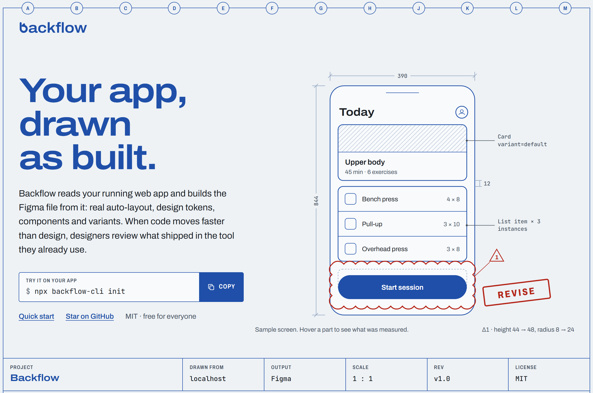
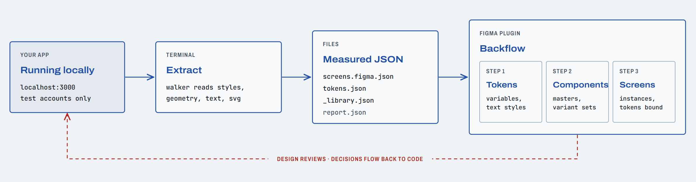
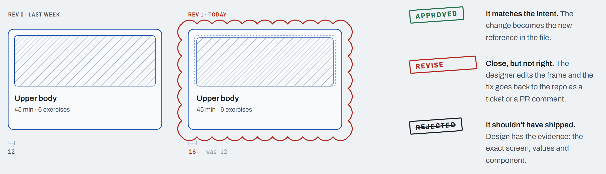
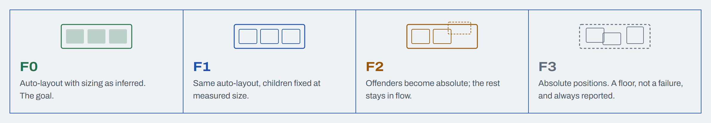

<p align="center">
  <a href="https://github.com/asiln/backflow">
    <picture>
      <source media="(prefers-color-scheme: dark)" srcset="docs/assets/hero-dark.png">
      
    </picture>
  </a>
</p>

<p align="center">
  <a href="https://www.npmjs.com/package/backflow-cli"></a>
  <a href="LICENSE"></a>
  
  
  <a href="https://github.com/sponsors/asiln"></a>
</p>

**Backflow** reads your running web app and builds the Figma file from it: real auto-layout, editable text, vector icons, design tokens, components and variants. Sizing (Hug, Fill, Fixed) comes from how the page actually renders, not from your source code, so it works with React, Tailwind or any site.

The order used to be design first, build second. Now code changes every day and the Figma file falls behind. Backflow runs the other way, so designers can review what shipped, in the tool they already use, and approve, revise or reject it.

> Use it on **local or staging apps with test accounts only**. The extractor refuses non-localhost origins. Exports can contain real app text and images, so keep `out/` private.

## Quick start

```sh
npx backflow-cli init                  # writes screens.json and backflow.config.json here
npx backflow-cli extract screens.json  # -> out/screens.figma.json, plus a report per screen
npx backflow-cli plugin                # copies the Figma plugin to ./backflow-figma-plugin
```

In **Figma desktop**: Plugins → Development → Import plugin from manifest → `backflow-figma-plugin/manifest.json`. Run **Backflow** and drop `out/screens.figma.json` anywhere on its window.

For a design system too, harvest tokens and components first, then drop all three files on the plugin (Tokens → Components → Screens):

```sh
npx backflow-cli tokens --in "out/*.figma.json" --out out/enriched
npx backflow-cli components --in "out/*.figma.json" --out out/enriched
```

Requirements: Node 18+, a Chromium (`npx playwright-core install chromium`, or set `BACKFLOW_CHROME`; system Chrome and Edge are tried), and Figma desktop for the plugin. Install it globally with `npm i -g backflow-cli` to type `backflow` instead of `npx backflow-cli`.

## How it flows back

<picture>
  <source media="(prefers-color-scheme: dark)" srcset="docs/assets/flow-dark.png">
  
</picture>

1. `walker.js` runs inside the page and reads computed styles, geometry, text, SVG icons and images.
2. `backflow extract` logs in (local test accounts only), opens each screen in a batch, runs the walker, and writes `out/<batch>.figma.json`. It reports problems: 404, redirect to login, `???`, error toasts, spinners, empty screens.
3. `backflow tokens` and `backflow components` harvest variables, text styles and repeated UI across every screen.
4. The **Backflow** plugin builds it in Figma: Tokens, then Components, then Screens as instances with tokens bound.
5. `backflow run` and `backflow pipeline` capture whole folders of batches, with setup and cleanup around each.
6. `backflow diff` compares a real screenshot with a re-render built only from the JSON, to catch systematic extraction errors.

## Built for review, not for redrawing

<picture>
  <source media="(prefers-color-scheme: dark)" srcset="docs/assets/review-dark.png">
  
</picture>

Run it again after every merge. Tokens and components are matched by key, so a new run updates the file instead of piling up duplicates, and nothing a designer made is deleted, renamed or overwritten.

## What lands in Figma

| | What you get | How it's measured |
|---|---|---|
| **Auto-layout** | Real auto-layout with Hug, Fill and Fixed sizing, gaps, padding, alignment, wrap and grids. | Style-override probes in the browser, checked by an auto-layout simulator, re-checked in Figma. |
| **Tokens** | Colour variables, text styles, radii and spacing, bound to every layer that uses them. | Harvested across all screens; re-runs match by key and never duplicate. |
| **Components** | Master components, variant sets and icon sets. Screens import as instances. | Repeated structures found by signature, with a confidence score on each. |
| **Screens** | Editable text, vector icons, images, gradients and shadows, laid out in one Section. | Every screen gets a report: what was lost, where, and why. |
| **RTL** | Right-to-left rows in visual order, Persian text in Vazirmatn. | `???` corruption is detected and flagged, never imported silently. |

<picture>
  <source media="(prefers-color-scheme: dark)" srcset="docs/assets/ladder-dark.png">
  
</picture>

## General notes

1. **Local only.** Extraction runs on your machine with Playwright, against localhost. No Figma API quota, no cloud upload.
2. **No network in Figma.** The plugin declares no network access, so app data never leaves the file.
3. **Measured, not guessed.** Every layout decision comes from what the browser rendered and is checked before it's trusted.
4. **Honest about loss.** When fidelity drops, the container steps down a level, the import keeps going, and the report says where and why.
5. **Previews first.** Tokens and Components preview every change before anything is written to the file.
6. **Old files keep working.** New fields are optional. An export from an older version (including Figma Lift) still imports.

## Free for everyone, built by everyone

Backflow is MIT licensed and community run. There's no paid tier and no account.

- **Star and follow** the repo for releases and the roadmap.
- **Contribute**: fixtures, extractor fixes, plugin features, docs. Start with [CONTRIBUTING.md](CONTRIBUTING.md).
- **Discuss**: questions, ideas and show-and-tell in [Discussions](https://github.com/asiln/backflow/discussions).
- **Sponsor**: if it saves your team a week of redrawing screens, [help keep it free](https://github.com/sponsors/asiln).

Backflow is an independent open-source project and is not affiliated with Figma, Inc. Formerly **Figma Lift**: old config files, environment variables (`FIGMA_LIFT_*`) and exports keep working.

---

# Reference

Every command below works as `backflow <command>` (installed), `npx backflow-cli <command>`, or from a clone as `node <script>.mjs` (`extract.mjs`, `run-all.mjs`, `pipeline.mjs`, `tokens.mjs`, `componentize.mjs`, `diff.mjs`). Through the CLI, `out/`, saved sessions and `backflow.config.json` live in the folder you run it from; from a clone they live in the clone.

```
backflow extract batches/test.json                 # -> out/test.figma.json
backflow extract batches/test.json --only dash     # only screens whose name contains "dash"
backflow extract batches/test.json --strict        # exit code 2 if any screen looks broken
backflow run batches/athlete                       # every *.json in the dir -> out/athlete/<batch>.figma.json + summary.json
backflow run batches/athlete --only programs       # filter by batch file name or screen name
backflow diff batches/test.json --screen Dashboard # -> out/diff/<slug>.{real,render,side}.png + pixel-diff report
```

Persian must never go through shell arguments (it turns into `???`). Put it in batch files; the extractor flags `???` in screen names, setup scripts and page text.

### Batch file

```json
{ "phone": "test-user-id", "width": 390, "height": 844, "fullPage": false,
  "screens": [ { "name": "Athlete / Dashboard / 390", "path": "/dashboard",
                 "setup": "click('^Save$'); await sleep(800)", "delayMs": 2500, "tutorial": false,
                 "fullPage": true, "selector": "[role=dialog]", "backdrop": true,
                 "width": 1280, "height": 800 } ] }
```

Omit `phone` for logged-out pages. `setup` is async JS with `sleep(ms)` and `click(regexString)`, for opening sheets, tabs and steps.

Optional batch / screen fields (all additive; old batches keep working):

| Field | Where | Meaning |
|---|---|---|
| `fullPage` | batch or screen | `true`: grow the viewport to the full content height and expand overflow auto/scroll containers to their scroll height before walking. Default `false` (unchanged). |
| `selector` | screen | CSS selector; capture only that element (frame size = element box, `src` = its page position). Waits up to 5 s for it to be visible. |
| `backdrop` | screen | With `selector`: capture the full-viewport fixed/absolute overlay wrapper around the element instead of the element alone (so the dimmed backdrop is included). |
| `width`, `height` | screen | Override the viewport for this screen. |
| `base`, `api` | batch | Unchanged (localhost only). |

### CLI

`node extract.mjs <batch.json> [out.json] [--only <substring>] [--strict]`, also importable: `import { runBatch } from './extract.mjs'`.
A crash in one screen no longer aborts the batch; it is reported as `ERROR: capture failed` and the screen is skipped.

### Warnings in the report

Each report entry has `warnings` (strings) and `broken` (true if any starts with `ERROR`).

- ERROR: HTTP status >= 400, navigation failure, 404 page, app error screen, redirect to login/register/otp when the path was not an auth page, `???` in text, 3+ skeleton placeholders, error toast (text with خطا/ناموفق/مشکل/error/failed), empty screen (fewer than 8 nodes or no text; for `selector` captures only "nothing matched").
- warn: spinner-like elements, loading text, other toasts, 1-2 skeleton elements, images that became placeholders, uncaught page errors.

### Pipeline (one command for many batches)

`run-all.mjs` runs every batch in a folder and nothing else. When the batches need app state prepared first (reset a test account, switch a setting, start a session) and cleaned up afterwards, describe the whole sequence in `<batches dir>/_pipeline.json` and run it with one command:

```
backflow pipeline batches/app                       # everything -> out/final/app/
backflow pipeline batches/app --dry-run             # print the plan and check the batch files, run nothing
backflow pipeline batches/app --only checkout       # one step (exact name wins, else substring)
backflow pipeline batches/app --from checkout       # this step and all after it
backflow pipeline batches/app --out some/dir        # output root (default out/final)
```

`run-all.mjs` is unchanged. The manifest:

```json
{
  "preflight": ["curl -sf http://localhost:3000 > /dev/null", "test -n \"$BACKFLOW_TEST_PASSWORD\""],
  "steps": [
    { "batch": "home.json" },
    { "batch": "signup-flow.json", "before": ["psql -f reset.sql"], "after": ["psql -f restore.sql"], "retries": 1, "deleteState": ["phone"] },
    { "batch": "../public/landing.json", "onlyIfMissing": true }
  ],
  "finally": ["psql -f restore.sql"]
}
```

- `preflight`: shell commands that must all exit 0. If one fails no step runs (`finally` still does).
- `steps`: run in order, one extraction at a time, in its own child process (so a stuck page can be killed by `stepTimeoutMin`, default 45). `batch` is relative to the batches dir.
  - `before` / `after`: shell commands around the extraction. A failing `before` skips the extraction; `after` always runs, so a failed attempt still restores what `before` changed.
  - `retries`: extra attempts for the whole step (before, extract, after). Used when the extraction throws, times out, or captures fewer screens than the batch lists, for example after `Execution context was destroyed` (the report notes `contextDestroyed`).
  - `deleteState`: saved sessions to delete after the step (even when it failed). `"phone"` stands for the batch's own `phone`; any other string is used as the id in `state-<id>.json`. Use it for one-shot batches and whenever a hook logs the same account in through the API.
  - `onlyIfMissing`: skip when a complete output (frames at least the screen count) already exists.
- `finally`: always runs, every command, failures are recorded.
- `commandTimeoutSec` (default 180) limits each shell command.

Every step is fail-soft: an error is recorded and the next step runs. An output with fewer frames than the batch has screens is refused: the step is marked failed and any earlier good output is kept (flagged as previous output in the summary).

Shell commands run through `sh -c` (Git Bash on Windows, or `$PIPELINE_SHELL`) with the tool folder as cwd, `MSYS_NO_PATHCONV=1`, and these variables: `PIPELINE_TOOL_DIR`, `PIPELINE_BATCH_DIR`, `PIPELINE_OUT_DIR`, and per step `PIPELINE_STEP`, `PIPELINE_PHONE`. Never print secrets from a hook; the pipeline logs the command text and the last lines of failing output.

Output, per batch directory name (the folder that holds the batch file, so a step with `../public/landing.json` writes to `out/final/public/`):

| File | Content |
|---|---|
| `out/final/<dir>/<batch>.figma.json` | the import file |
| `out/final/<dir>/reports/<batch>.report.json` | the per-screen report |
| `out/final/<manifest dir>/summary.json` | all steps: status, screens expected vs captured, size, F0 average and minimum, broken and warned screens, attempts, errors |
| `out/final/<manifest dir>/SUMMARY.md` | the same as a table, plus failed steps, screens below 90% F0 and flagged screens |

Running with `--only` or `--from` keeps the other rows of the previous summary (marked as from an earlier run). Exit code 0 means all good, 1 means a step, preflight or finally command failed, 2 means everything ran but some screens look broken. Ctrl+C stops the current extraction and still runs `finally`.

`extract.mjs` also accepts `--report <file>` to write the per-screen report as JSON. The manifest logic is covered by `tools/pipeline.test.mjs` (fake extractor and fake shell, no browser): `npm test`.

### Install the plugin once (Figma desktop app)

`backflow plugin` copies it next to you; from a clone use `plugin-lift/` directly.

**Recommended: one plugin for everything.** Go to Plugins, then Development, then Import plugin from manifest, and choose `plugin-lift/manifest.json`. Run **Backflow**. It opens as a checklist for the current file: Fonts → Tokens → Components → Screens. Each row says what the file already has and what is missing.

- Drop any number of `tokens.json`, `_library.json` and `*.figma.json` files anywhere on the window, or paste one. Each file lands in its own row with a summary of what's inside.
- Tokens and Components have **Preview** (changes nothing) and **Apply**. Apply shows how many items it will create once you've previewed, and asks once if you haven't previewed.
- Results come back as numbers rather than a log dump: counts per status, the F0–F3 auto-layout ladder, design-system bindings, and the exact failure reasons. The raw log is still there, with a copy button.
- After a clean apply the plugin checks the file again and opens the next step. It follows Figma's light and dark theme and remembers your options and window size.

`plugin-lift/code.js` is generated: `npm run build:lift` bundles the three engines below, unchanged, behind one window (`plugin-lift/host.js`). `npm run check` fails when it's stale. `tools/lift-preview.html` runs the UI in a browser with a fake host, for working on it without Figma.

The three single-purpose plugins below still work on their own.


Plugins, then Development, then Import plugin from manifest, then choose `plugin/manifest.json`.
Run it from Plugins, then Development, then Backflow Import. Paste or choose the JSON, then Build layers.

Options in the plugin window:

- **Section name** (default: the batch name from the JSON). Every import is wrapped in a Section placed to the right of existing content; frames are laid out in a grid, 80 px gaps, wrapping at about 6000 px.
- **Bind colours to local variables**: reads local COLOR variables (default mode of each collection, aliases resolved) and binds solid fills, strokes and text colours whose RGBA matches exactly. When several variables match, the collection named `Color` beats other collections, and `Primitives` is last. Does nothing if the file has no local COLOR variables.
- Progress bar, Cancel button, and a final summary with counts and failures (svg, image placeholders, nodes, style steps, plus the first error messages).

### JSON schema (summary)

`{ figmaLift: 1, name?, assets?: { id: dataUrl }, frames: [node] }`

Node: `{ t: 'frame'|'text'|'svg'|'img', name, x, y, w, h, ... }`. Existing fields: `fill, stroke{c,w[4],style}, radius, shadow[], blur, bblur, opacity, clip, layout, children, text, font, svg, data`. Optional fields added later (older consumers can ignore them):

- images: `data` (png/jpeg data URL) or `asset` (key into top-level `assets`, used when the same image appears twice), `fit` (`FILL|FIT|CROP|TILE`), `tf` (2x3 crop transform for `CROP`), `iw/ih`, `alt`, `failed` / `needsFetch` (placeholder reason), `radiusArr` (per-corner radii if not uniform). `fill/stroke/shadow` also appear on img nodes.
- frame backgrounds: `layers` = CSS-ordered (top first) list of `{k:'grad',...}` and `{k:'img', data|asset, mode, tf, scale}`; `grads` is still emitted for gradient-only backgrounds.
- text: `runs: [{s,e,family?,size?,weight?,color?,deco?}]` (ranges where inline spans differ from the base style), `font.shadow {c,x,y,blur}`.
- effects: `shadow[].inset` (becomes INNER_SHADOW), several shadows per node.
- `xf: [a,b,c,d,tx,ty]` rotation/flip in parent space (children are measured untransformed), `blend` (mix-blend-mode), `pos` (`fixed|sticky`), `z` (non-zero z-index; siblings are already emitted in paint order).
- root: `src {x,y}` (page position of a selector capture).
- names: aria-label, data-testid, role, or a semantic tag (`button · label text`, `nav`, `h2 · title`, `overlay`).

### What the walker handles

- **Images**: ``, `<canvas>`, `<video>` frame, and CSS `background-image: url()` are re-encoded in the page via canvas to PNG (JPEG when PNG would exceed ~1.5 MB), downscaled to at most 1600 px, so webp/avif/svg all work. `object-fit`/`object-position`, `background-size`/`position`/`repeat`, and border-radius (px, %, rounded-full) are mapped to scale modes. Cross-origin images that the page cannot read are downloaded by Playwright and converted. If everything fails the node becomes a labelled gray placeholder (never a crash).
- **SVG**: computed `fill`, `stroke`, widths, caps, dashes, opacity, `stop-color` are written onto every cloned element (so CSS classes and `currentColor` survive), `<use>` and `<symbol>` are expanded, gradients/clipPaths defined elsewhere in the page are pulled in, the root keeps its `viewBox` and is sized to the rendered box.
- **Text**: plain inline markup (`b`, `span`, `a`, `br`...) becomes one text node with `runs`; text split by block/inline-block children becomes one node per run of text; line-box half-leading is added back so Figma text lands where the browser drew it; gradient text uses its first stop; text containing Persian falls back to Vazirmatn when the CSS stack named a Latin-only font first.
- **Layout fidelity**: z-index paint order among siblings, fixed/sticky bars kept in place (the plugin adds constraints), rotate/flip, `mix-blend-mode`, text-shadow, inset and multiple box-shadows.

### Fidelity check (`diff.mjs`)

Takes a real screenshot and a screenshot of an HTML re-render built from the JSON (absolutely positioned boxes, text, inline svg, images, the app's own @font-face renamed to Vazirmatn / Space Grotesk / JetBrains Mono), prints the pixel-difference percentage (channel delta above `--threshold`, default 24), per-type averages, the worst nodes and hot 60 px cells, and saves `<slug>.side.png` (real | render | diff). Text anti-aliasing alone gives roughly 25-30% difference inside text boxes; look for large blocks in the diff panel instead. `fixtures/serve.mjs` + `batches/fixture.json` is a local test page covering images, svg, transforms, runs, scroll containers and a bottom sheet.

`plugin-mock.mjs <file.figma.json> [bind]` runs the plugin code against a mocked Figma API (see above). It catches JS errors and API misuse, not rendering differences.

### Real auto-layout (`ls`)

Design and rationale: `docs/AUTO-LAYOUT-SPEC.md`. Things still to be confirmed in real Figma: `docs/VERIFY-IN-FIGMA.md` (a small test plugin in `plugin/verify/`).

Pipeline: `walker.js` collects layout facts (`lf`: display, flex/grid props, margins, min/max, positions, text lines/line height/truncation) and runs style-override probes on every frame (width auto, width max-content, height auto, height with `align-self:flex-start`, which inset sides are authored, grid `fr` tracks). Probes restore the inline styles; they are capped at 9 s per screen (`probeBudgetMs`) and cost about 100-200 ms per screen in practice. `normalize.mjs` (called by `extract.mjs`) turns the facts into a compact `ls` object per node, checks it with a small auto-layout simulator (`layout-sim.mjs`, tolerance 1.5 px) and applies the ladder per container:

| Level | Meaning |
|---|---|
| F0 | auto-layout with FIXED / HUG / FILL children as inferred |
| F1 | same container, every child FIXED at its measured size |
| F2 | offenders become ABSOLUTE children, the rest stays in flow |
| F3 | no auto-layout (`k: 'N'`), children keep absolute x/y (the pre-`ls` behaviour) |

`ls` fields. Container: `k` (`H`, `V`, `W` wrapping row, `G` grid, `N` none), `lv` (planned level 0-3), `g` item spacing, `g2` counter-axis spacing (wrap), `p` [top,right,bottom,left] content offset (CSS padding + border), `bw` the part of `p` that is a drawn stroke, `pa` primary and `ca` counter alignment, `cols`/`rows`/`cg`/`rg` for grids (`{t:'FLEX'|'FIXED'|'HUG', v}`). Child: `s` [horizontal, vertical] each `F` fixed, `H` hug, `L` fill; `abs` + `cn` [horizontal, vertical constraint] for out-of-flow children; `mn`/`mx` min and max size; `gp` [row, col, rowSpan, colSpan] and `ga` for grid cells; `sp` marks a spacer frame. Text: `tx` {`l` lines, `lh` line height px, `nw` nowrap, `tr` truncation lines, `ta` text-align override, `bx` the box is the container's content box}. Everything is optional: JSON without `ls` (older exports) imports exactly as before.

Structure changes the normalizer makes: inert single-child wrappers are merged away; RTL rows are ordered by visual x (Figma has no direction property); uneven gaps become an `itemSpacing` plus invisible spacer frames named `gap`; children that do not follow the container's cross alignment get a transparent `align` wrapper frame (or text-align when they are text); wrapped rows become `W`, CSS grids become `G`.

Plugin side (`plugin/code.js`): builds in the order create, style, `resize` once, append, `layoutMode` and padding, children, child sizing (`textAutoResize` then `resize` then `FILL`), min/max; ABSOLUTE children get `layoutPositioning` and constraints. After a container is built, the plugin compares each child's real bounds with the measured rectangles (text size errors from different font metrics are tolerated and budgeted) and steps that container down the ladder if it deviates (F0, F1, F2, F3). The import log prints counts per level, how many containers degraded in Figma, and the first reasons. Unverified runtime facts are constants in `CFG` at the top of `plugin/code.js`.

Options and flags:

- Plugin window: "Auto layout (when the JSON has it)" checkbox (default on). Off imports with absolute positions.
- `node extract.mjs batch.json --no-layout` skips the walker probes and normalizer (old output); batch/screen field `"layout": false` does the same per screen.
- Report entries carry `layout`: percent of containers at F0..F3, container kinds, wrappers, spacers, absolute children, sizing counts (hug/fill/fixed), failure causes and the walker timing.
- `node diff.mjs batch.json --ls` re-renders the JSON with Chrome flexbox/grid built from `ls` (HUG/FILL/gaps/alignment) instead of absolute boxes, so a wrong spec shows up as a pixel difference. Without `--ls` the render is unchanged.
- `node plugin-mock.mjs file.figma.json [--text-scale=1.05] [--no-grid] [--no-layout]` runs the plugin against a mock with its own layout engine, reports violations of documented API rules (FILL outside auto-layout, HUG on a rectangle, text FILL with WIDTH_AND_HEIGHT, resize after layoutSizing ...) and a position-fidelity percentage. It is not Figma.

Known limits: BASELINE alignment is approximated by geometry (and may need an `align` wrapper), `position:fixed` children stay inside their DOM parent instead of being hoisted to the screen, grid subgrid/dense/auto-fill layouts only work when the computed tracks are plain pixels, negative margins fall to F2/F3, RTL wrap rows start on the left in Figma, aspect ratio is not locked, percent/viewport sizes are frozen at the captured width (each width is its own frame).

### Components and design system

Two more commands turn the exported screens into a reusable library inside the same Figma file:

```
backflow tokens --in "out/final/**/*.figma.json" --out out/enriched --report       # colours, text styles, radii, spacing -> tokens.json
backflow components --in "out/final/**/*.figma.json" --out out/enriched --report  # repeated structures -> _library.json, cmp/tok on every screen
```

Then, in Figma (development plugins, everything in one file):

1. **Backflow Tokens** (`plugin-tokens/`): paste `tokens.json`, dry run, apply. Creates variables and text styles, never duplicates. See [docs/PLUGIN-TOKENS.md](docs/PLUGIN-TOKENS.md).
2. **Backflow Components** (`plugin-components/`): paste `_library.json`, dry run, apply. Builds components, variant sets and icon sets. See [docs/PLUGIN-COMPONENTS.md](docs/PLUGIN-COMPONENTS.md).
3. **Backflow Import** with "Use components" and "Bind tokens": screens become instances of the masters with variables bound. See [docs/PLUGIN-IMPORT.md](docs/PLUGIN-IMPORT.md).

Everything degrades gracefully: a missing master or a failed override gives a plain frame, never an aborted import. Design and measured Figma behaviour: [spec](docs/COMPONENTS-AND-DESIGN-SYSTEM-SPEC.md), [results](docs/VERIFY-DS-RESULTS.md).

### Notes and known limits

- Local app only (the extractor refuses non-localhost). Never run it against production.
- Auto-layout: see "Real auto-layout" above. Containers that cannot be reproduced keep absolute positions (F3).
- Needs Vazirmatn, Space Grotesk and JetBrains Mono available in Figma (all Google Fonts).
- Not captured: pseudo-elements (`::before/::after`), `clip-path`/`mask`, filters other than blur, `backdrop-filter` other than blur, video frames from cross-origin sources, `foreignObject` in SVG, repeating gradients (drawn as plain gradients), `list-style` markers (ignored on purpose).
- Rotated elements with a non-unit scale lose the scale (Figma transforms cannot scale). Skew is ignored.
- Bidi isolates (`dir="ltr"` spans inside RTL text) become separate text nodes when they are inline-block; inline ones rely on Figma's own bidi ordering.
- `fullPage` resizes the viewport (max 20000 px) so `100vh` layouts and fixed bars end up at the bottom of the capture; very tall pages with lazy content may need a larger `delayMs`.
- A batch with many large photos produces large JSON (each image is at most ~1.5 MB; images used more than once are stored once under `assets`).

### Configuration and private files

Nothing project-specific or secret lives in the tool itself.

- `backflow.config.json` (gitignored, copy from `backflow.config.example.json`): base and API URLs, login endpoint and field names, locale, localStorage keys to pre-set. Override the path with `$BACKFLOW_CONFIG`. The pre-1.0 `figma-lift.config.json` and `$FIGMA_LIFT_*` variables are still read.
- Test password: `$BACKFLOW_TEST_PASSWORD` (never committed, never in a batch file).
- `batches/` (gitignored): your real screen lists. `batches.example/` shows the format.
- `out/` (gitignored): exports. `state-*.json` (gitignored): saved sessions.
- Use local or staging apps and test accounts only. The extractor refuses non-localhost origins.

---

| Rev | Date | Description |
|---|---|---|
| v1.0 | 2026-11 | First release as Backflow: one plugin, tokens, components, variants, the `backflow` CLI. |
| v0.1 | 2026 | Released as Figma Lift. |

<sub>MIT License · Brand assets in [brand/](brand/) · Drawn from localhost, scale 1 : 1.</sub>
